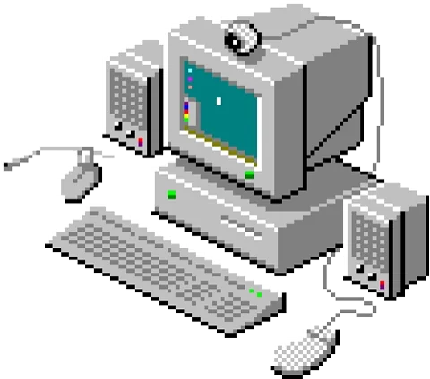
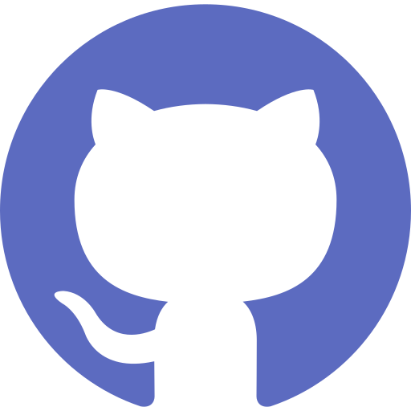
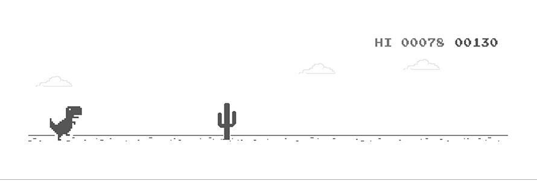

<h1 align="center">Dídac Fernández</h1>
<p align="center">
    
</p>

```
  _____     ____                                       _____     ____                                       _____     ____ 
 /      \  |  o |                                     /      \  |  o |                                     /      \  |  o |
|        |/ ___\|                                    |        |/ ___\|                                    |        |/ ___\|
|_________/                                          |_________/                                          |_________/
|_|_| |_|_|                            __ __ __ __   |_|_| |_|_|                            __ __ __ __   |_|_| |_|_|
```

<h3>
    <picture></picture> 
    About me:
</h3>

<ul>
    <li>📖 4th-year Mechatronics Engineering student at the University of Vic (UVic-UCC), Spain.</li>
    <li>🤖 Focused on robotics software (<b>ROS 2, C++, Python</b>) and SITL simulation (<b>Gazebo, MuJoCo</b>).</li>
    <li>🚜 Ex-Robotics Software Intern at <b>Agrin'pulse</b> (SITL simulation &amp; embedded control).</li>
    <li>🐗 3 years on  
        <i><a href="https://github.com/Garrins-Metal-lics" target="_blank">my university’s robotics team</a></i> (3rd place at Eurobot Spain 2026).
    </li>
    <li>🌱 Currently exploring:
    <ul>
      <li>Behavior Trees &amp; multi-robot systems (Bachelor's Thesis starting Jan 2027)</li>
      <li>Machine Learning &amp; Reinforcement Learning</li>
      <li>PCB Design (Altium)</li>
    </ul>
    </li>
    <li>🤝 Looking for a <b>Summer 2027 R&amp;D / robotics internship</b> and open to collaborating on robotics projects.</li>
    <li>🔒 <i>Note: Most of my recent work (Agrin'pulse &amp; Eurobot) lives in private repositories due to confidentiality.</i></li>
    <li>❤️ I love taking on big challenges, learning new things, and building creative and useful solutions.</li>
    <li>💬 Feel free to reach out — always happy to talk robotics!</li>
</ul>

<h3>
    
    Skills:
</h3>
<h4>📋 Languages, ♾️ DevOps, 💾 Databases & 🖼️ Others:</h4>
<span> 
    
    
    
    
    
    
    
    
    
    
</span>
<h4>💻 IDEs & 🎛️ Operating Systems:</h4>
<span>
    
    
    
    
</span>

<!-- <h3>
    <picture></picture> 
    GitHub Stats:
</h3>
<div style="display: flex; justify-content: space-between;">
    
    
</div>
<br><br><br><br><br><br><br><br> -->
<h3 align="left">
     
    For more information contact me via:
</h3>
<p align="center">
    <a href="mailto:didac.fernandez.monedero@gmail.com" >
        
    </a> &nbsp;&nbsp;
    <a href="https://www.linkedin.com/in/didacfernandezmonedero" target="_blank">
        
    </a> &nbsp;&nbsp;
    <a href="https://profile-summary-for-github.herokuapp.com/user/difermon09" target="_blank">
        
    </a> 
</p> 

<div align="center">
    :heart_eyes: Thanks for visiting my profile! Have a nice day! :wink: <br/>
    &copy; 2026 Dídac Fernández
    <h3>
        
    </h3>
</div>
